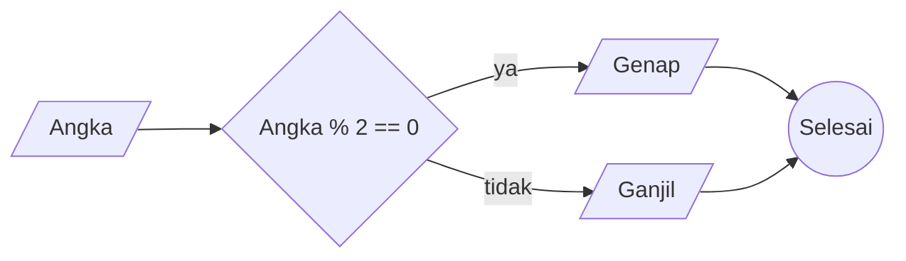

# Algortima

## Memindahkan teh dari teko ke gelas kosong

1. Mulai
2. Siapkan teko berisi teh
3. Siapkan gelas kosong
4. Tuangkan isi teh dari teko ke dalam gelas kosong
5. Selesai

## Menentukan ganjil dan genap

1. Mulai
2. Menentukan angka yang ingin dipilih apakah ganjil atau genap
3. Jika angka tersebut habis dibagi 2 atau angka sama dengan 0 maka bilangan tersebut merupakan genap
4. Dan jika angka tersebut dibagi 2 sisa baginya tidak sama dengan 0 maka bilanga tersebut merupakan ganjil
5. Selesai

